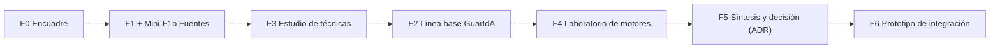

# Estudio de arquitectura de inferencia de GuarIdA

> **Rama:** `estudio/motores-inferencia` · **Inicio:** 2026-11-28 · **Estado global:** Fases 0, 1, Mini-F1b, 3, 2 y 4 cerradas; siguiente fase: **F5 (ADR 0014) → F6**
>
> Documento raíz del estudio. Si retomas el trabajo (persona u otro modelo), lee primero [TRASPASO.md](TRASPASO.md).

## 1. Por qué existe este estudio

El proyecto [`alesha-pro/llm.asm`](https://github.com/alesha-pro/llm.asm) (`01-qwen3-inference` y `02-baremetal-os`) demostró que Qwen3-0.6B puede ejecutarse con mucha más eficiencia que la de un motor generalista cuando se elimina fricción alrededor del modelo (pesos mapeados sin copias, kernels SIMD concretos, KV-cache persistente, especialización en un único modelo).

La pregunta no es "¿escribimos GuarIdA en ensamblador?", sino:

> **¿Estamos tratando al modelo de la mejor forma posible para el hardware doméstico que GuarIdA quiere servir, y qué piezas de otros motores podemos incorporar para hacerlo mejor?**

Es un paso crucial de arquitectura: decide si GuarIdA sigue dependiendo de un único motor (`llama-server`), pasa a un esquema de motores intercambiables o acaba evolucionando hacia un planificador adaptativo propio (idea *AdaptiveLLM*).

## 2. Punto de partida (lo que GuarIdA ya tiene)

Esto es importante porque cambia el enfoque: **GuarIdA ya tiene buena parte de la "capa de inteligencia" que propone AdaptiveLLM**; lo que es monolítico es la capa de ejecución.

| Capa AdaptiveLLM propuesta | Equivalente actual en GuarIdA | Estado |
|---|---|---|
| Hardware Intelligence | `hardware.py`, `hardware_detectors.py`, `memory_probe.py` (CPU, RAM, VRAM/GTT, prueba de estrés) | Existe |
| Performance Predictor / perfiles | `tuning/` (afinador empírico por etapas: ngl → threads → batch → fa/kv → ctx) + `configuraciones_optimas` en SQLite | Existe, solo para llama.cpp |
| Model Intelligence | Inspección GGUF (ADR 0008), `tensors_engine.py` (safetensors) | Parcial |
| Execution Planner / Scheduler | Elección de flags de `llama-server` | Monolítico (un motor) |
| Inference Runtime | `llama-server` vía HTTP (`engine/server.py`, `engine/client.py`) | Un solo motor |

Observaciones previas (a confirmar en Fase 2):

- `LlamaServerConfig` ya admite `-fa`, KV cuantizada, `-md`, `--lookup-cache`, `--cache-reuse`, `--n-cpu-moe` y `-ot`, pero el afinador **no** explora decodificación especulativa, *lookup* ni reparto de expertos MoE.
- El afinador mide un rendimiento "de una sola petición". La carga real de un agente de código es distinta: **contextos largos, prefijos repetidos y prefill dominante**. La comparativa histórica del README (0,80 t/s en contexto largo) apunta a que el dolor real está ahí, no en la velocidad bruta de *decode*.
- Como GuarIdA habla con el motor por HTTP (API tipo OpenAI), cualquier motor con servidor compatible se puede probar **sin tocar el arnés**. Esto abarata muchísimo el estudio.

## 3. Preguntas de investigación

1. **P1 · Rendimiento por recurso:** ¿qué motor/configuración da más rendimiento útil (TTFT, prefill, decode) por GB de memoria y por vatio en cada perfil de hardware de GuarIdA?
2. **P2 · Carga de agente:** ¿qué técnicas reducen más el coste de contextos largos con prefijos repetidos (reutilización de KV, caché de prefijos, guardado de *slots*, KV cuantizada)?
3. **P3 · Modelos mayores en hardware modesto:** ¿cuánto se gana con MoE (Qwen3-30B-A3B y sucesores) usando reparto selectivo de expertos RAM/VRAM frente a un modelo denso de 8B?
4. **P4 · Generar menos pasos:** ¿cuánto aportan la decodificación especulativa (modelo borrador, EAGLE, MTP, n-gram/lookup) en cargas de código?
5. **P5 · Arquitectura:** ¿qué componentes merece la pena **integrar** (motor intercambiable), cuáles **imitar** (técnica reimplementada) y cuáles solo **estudiar**?
6. **P6 · Coste para GuarIdA:** licencia compatible con GPL-3.0, funcionamiento offline, Windows + Linux, tamaño de distribución, mantenimiento.

## 4. Reglas del estudio

1. **Ninguna cifra sin medición o fuente verificada.** Las cifras de la conversación con ChatGPT y de los README de terceros son *afirmaciones del autor*, no hechos. Se marcan como tales hasta reproducirlas.
2. **Verificar existencia, licencia y soporte antes de invertir tiempo.** Algunos nombres de la conversación previa no traen enlace o pueden estar mal atribuidos (la propia conversación rectificó lo de DynaLM).
3. **Mismo modelo, misma cuantización, mismos prompts** al comparar motores. Los formatos nativos (OpenVINO INT4, MLC q4f16, ternarios, H3G…) se comparan en una tabla aparte, nunca mezclados con Q4 GGUF.
4. **Prioridad a la carga real de GuarIdA** (agente de código, contexto largo, un usuario) sobre los benchmarks de servidor multiusuario.
5. **Línea base obligatoria:** todo se compara con el `llama-server` que GuarIdA ya distribuye, **bien afinado** (no con valores por defecto).
6. **Calidad además de velocidad:** un motor más rápido que cambia la salida (cuantización distinta, kernels inexactos) debe pasar una puerta de calidad.
7. **Coger un poco de muchos está permitido** y es probablemente el resultado esperado. La decisión final se documenta en un ADR.

## 5. Fases del estudio

| Fase | Objetivo | Entregable | Criterio de salida | Estado |
|---|---|---|---|---|
| **F0 · Encuadre** | Fijar objetivo, reglas, fases, inventario inicial y protocolo | Esta carpeta + ADR 0013 (propuesto) | Documentación commiteada en rama de estudio | ✅ Cerrada |
| **F1 + Mini-F1b · Verificación de fuentes** | Comprobar en cada candidato: existe, licencia real, actividad, SO, backends, soporte Qwen3, formato de pesos, API de servidor, origen de sus benchmarks | Fichas verificadas en [01_inventario_candidatos.md](01_inventario_candidatos.md) y [01b_agregador_y_manual.md](01b_agregador_y_manual.md) | Todos los candidatos de prioridad A, B, C y emergentes (`Strata`, `RustingStrata`, `DFlash2`) verificados; `config.json` de Qwen3 confirmados | ✅ Cerrada *(2026-11-28)* |
| **F3 · Estudio de técnicas** | Leer código y documentación para entender *cómo* consigue cada proyecto su ventaja (T1–T20) | Fichas en [03_catalogo_tecnicas.md](03_catalogo_tecnicas.md) y [03b_fichas_tecnicas_apoyo.md](03b_fichas_tecnicas_apoyo.md) + plan N0 para F2 | Cada técnica clasificada (`integrar` / `imitar` / `solo estudiar` / `descartar`) y mapeada a GuarIdA | ✅ Cerrada *(2026-11-28)* |
| **F2 · Línea base GuarIdA** | Medir el `llama-server` actual con el protocolo, incluyendo el "Nivel 0" (experimentos `N0-1`..`N0-Up` definidos en F3) | [04_resultados_f2_linea_base.md](04_resultados_f2_linea_base.md) + [resultados JSONL](resultados/2026-11-28_731271e2_llama-b12017.jsonl) + [bench_estudio_f2.py](../../herramientas/bench_estudio_f2.py) | Pruebas A–C, F, G y Q ejecutadas en Perfil B real (88 mediciones sin errores; pendiente `N0-5`/`N0-Up` al tener Qwen3/`v1.0.0+`) | ✅ Cerrada *(2026-11-28)* |
| **F4 · Laboratorio de motores** | Ejecutar candidatos verificados con el mismo protocolo, por perfil de hardware | [05_resultados_f4_laboratorio.md](05_resultados_f4_laboratorio.md) + [resultados F4](resultados/2026-11-28_731271e2_f4_qwen3-4b.jsonl) + [bench_estudio_f4.py](../../herramientas/bench_estudio_f4.py) | Comparativa multimotor ejecutada en Perfil B (`Qwen3-4B Q4_K_M`, 8 perfiles) | ✅ Cerrada *(2026-11-28)* |
| **F5 · Síntesis y decisión** *(siguiente)* | Matriz de decisión ponderada y elección por niveles | ADR 0014 (decisión) | ADR aceptado por el responsable del proyecto | ⏳ Siguiente |
| **F6 · Prototipo de integración** | Implementar lo decidido (p. ej. interfaz de motores + planificador) | Código + tests en rama propia | Tests verdes y mejora medida frente a F2 | ⏳ Pendiente |

### Niveles de adopción (marco para F5)

La decisión final no tiene por qué ser "cambiar de motor". Se clasificará cada hallazgo en uno de estos niveles, de menor a mayor coste:

| Nivel | Qué significa | Ejemplos posibles (a validar) |
|---|---|---|
| **N0 · Exprimir lo actual** | Mejor uso de `llama-server`: flags, afinador, forma de construir prompts | KV `q8_0` + `-fa`, `-md` con Qwen3-0.6B, `--lookup-cache`, `-ot`/`--n-cpu-moe` para MoE, prefijos estables, `--slot-save-path` |
| **N1 · Binario sustituto** | Otro ejecutable compatible con la CLI/API de `llama-server` y con GGUF | ik_llama.cpp, quizá Ghost Infer |
| **N2 · Motor alternativo enchufable** | Otro motor con servidor compatible OpenAI, elegido por el afinador según hardware | OpenVINO GenAI (Intel), mistral.rs, MLC LLM (Vulkan), DynaLM, Golem |
| **N3 · Técnica reimplementada** | Se adopta una idea, no un proyecto | Reutilización de prefijos al estilo RadixAttention en el arnés, planificación de expertos |
| **N4 · Motor propio / AdaptiveLLM** | Planificador y/o kernels propios | Solo si F4/F5 demuestran que N0–N3 no bastan |

## 6. Documentos del estudio

| Documento | Contenido |
|---|---|
| [TRASPASO.md](TRASPASO.md) | Estado, siguiente tarea concreta y reglas para quien retome |
| [01_inventario_candidatos.md](01_inventario_candidatos.md) | Candidatos verificados en F1, fichas primarias, registro de afirmaciones y correcciones |
| [01b_agregador_y_manual.md](01b_agregador_y_manual.md) | Síntesis de `awesome-local-inference-recipes`, 12 proyectos emergentes, 4 modelos recientes y mapa del `LLM-Inference-Handbook` |
| [02_protocolo_benchmark.md](02_protocolo_benchmark.md) | Perfiles de hardware, modelos, pruebas, métricas y formato de resultados |
| [03_catalogo_tecnicas.md](03_catalogo_tecnicas.md) | Tabla T1–T20, fichas principales, plan N0 para F2 y base arquitectónica F5/F6 |
| [03b_fichas_tecnicas_apoyo.md](03b_fichas_tecnicas_apoyo.md) | Fichas completas de apoyo (`T1`, `T2`, `T3`, `T5`, `T11–T15`, `T17`) |
| [04_resultados_f2_linea_base.md](04_resultados_f2_linea_base.md) | Informe de resultados reales de Fase 2 (Perfil B i5-1135G7 + Iris Xe Vulkan) |
| [05_resultados_f4_laboratorio.md](05_resultados_f4_laboratorio.md) | Informe de Fase 4 (comparativa multimotor `Qwen3-4B Q4_K_M` en Perfil B) |
| [../adr/0013-estudio-arquitectura-inferencia.md](../adr/0013-estudio-arquitectura-inferencia.md) | ADR propuesto que abre el estudio |
| [resultados/](resultados/) | Prompts (`prompts/`) y JSONL de F2 y F4 |
| [bench_estudio_f2.py](../../herramientas/bench_estudio_f2.py) / [bench_estudio_f4.py](../../herramientas/bench_estudio_f4.py) | Runners reproducibles y reanudables para F2 y F4 |

## 7. Fuentes de partida

- Proyecto inspirador: <https://github.com/alesha-pro/llm.asm> (`01-qwen3-inference`, `02-baremetal-os`).
- Lista de proyectos aportada por el responsable del proyecto (ver inventario).
- Conversación previa con ChatGPT (2026-11): aportó la clasificación en tres líneas (ligeros, alto rendimiento, experimentales), una primera selección y un protocolo de pruebas. **Sus cifras y algunos datos técnicos no están verificados** (ver erratas detectadas en [02_protocolo_benchmark.md](02_protocolo_benchmark.md#erratas-detectadas-en-la-conversación-previa)).
- Agregador comunitario: <https://raytone-lab.github.io/awesome-local-inference-recipes/explore.html>.
- Manual teórico: <https://github.com/h9-tec/LLM-Inference-Handbook>.
