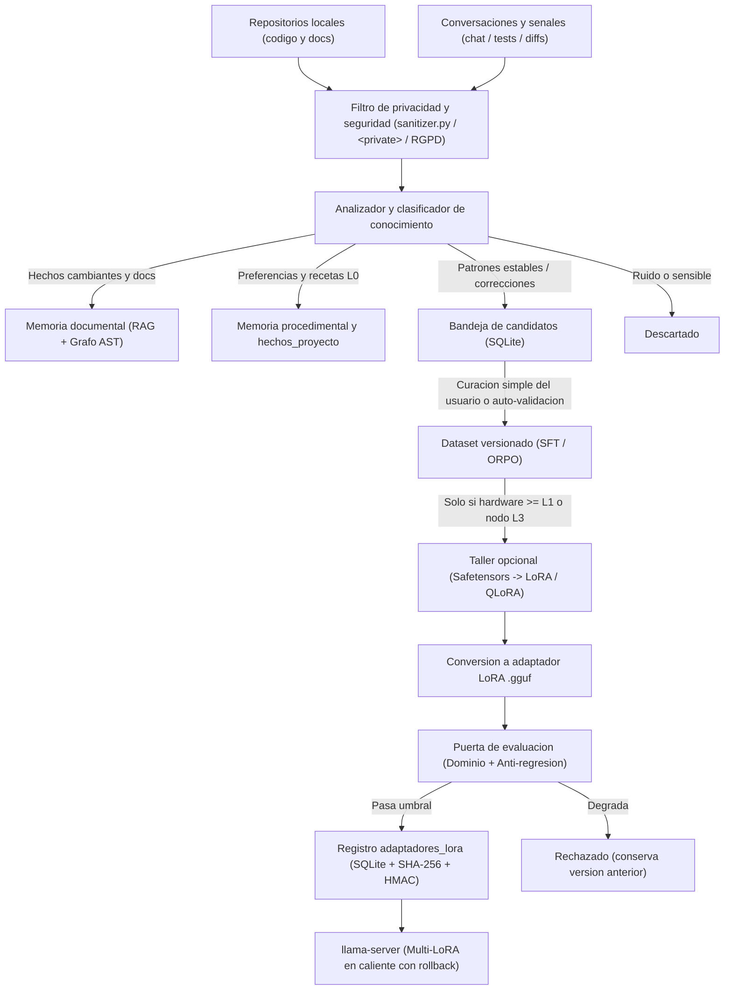

# 01 · Aprendizaje adaptativo local dependiente del hardware

> **Estado:** Visión futura / RFC conceptual (Fase 5+)  
> **Fecha:** 2026-11-28  
> **Origen:** Idea inicial planteada por el responsable del proyecto junto con Gemini, ampliada con análisis arquitectónico y opinión técnica propia adaptada a la realidad de GuarIdA.

---

## 1. Motivación y filosofía GuarIdA

La filosofía de GuarIdA parte de un principio innegociable: **automatizar procesos complejos para que no dependan de los conocimientos técnicos del usuario**. En inferencia, esto ya se traduce en detectar el hardware real (`hardware.py`), estresar la memoria (`memory_probe.py`), buscar el *Punto Dulce* (`tuning/`) y sugerir al usuario qué modelos puede mover con solvencia.

El siguiente salto natural es aplicar exactamente la misma filosofía a la **adaptación y aprendizaje del modelo**:
- Que un usuario doméstico, autónomo o pequeño equipo pueda coger un modelo base y **especializarlo con sus propios repositorios, manuales y experiencia de uso**, sin saber qué es un *rank* de LoRA, una tasa de aprendizaje o un formato JSONL.
- Que el sistema **decida qué estrategia de aprendizaje ofrecer según el hardware detectado** (desde un portátil modesto de 16 GB sin GPU dedicada hasta una estación con GPU de 24 GB o una red local mixta).
- Que todo ocurra **100 % en local y offline**, respetando la privacidad del búnker.

---

## 2. Opinión técnica propia y revisión crítica de la propuesta inicial

La conversación previa con Gemini aporta una base conceptual sólida, pero trasladarla directamente a GuarIdA sin ajustes provocaría fricciones graves con el hardware objetivo del proyecto y con sus garantías de privacidad. A continuación se detalla qué se adopta y qué debe corregirse o completarse.

### Aciertos que se adoptan
1. **Separar consulta de entrenamiento:** usar RAG para información viva/exacta y entrenamiento (LoRA/QLoRA) para estilo, patrones, terminología y procedimientos recurrentes.
2. **Aprendizaje continuo en lotes, nunca ciego tras cada turno:** acumular candidatos, validar calidad, versionar adaptadores y permitir *rollback* para evitar olvido catastrófico, contaminación y sobreajuste.
3. **Clasificar lo aprendido por naturaleza:** distinguir hechos documentales, experiencia/correcciones y preferencias de usuario.

### Lagunas y correcciones clave para GuarIdA

1. **El muro del hardware y del formato (`GGUF` vs. `Safetensors`):**
   GuarIdA ejecuta inferencia en `.gguf` sobre `llama-server` porque funciona bien en CPU, Vulkan/APU y GPUs modestas (Perfiles A y B de [02_protocolo_benchmark.md](https://github.com/Ydalgo/GuarIdA/blob/estudio/motores-inferencia/docs/estudio_inferencia/02_protocolo_benchmark.md)). Sin embargo, **no se entrena QLoRA directamente sobre un `.gguf` cuantizado en Q4_K_M**. Entrenar QLoRA en `bitsandbytes`/PyTorch requiere pesos en `Safetensors` (FP16/BF16 o cuantización entrenable NF4), suele exigir GPU CUDA (o ROCm/MLX en plataformas concretas) y añade dependencias de **2 a 5 GB** al entorno.
   - *Decisión de diseño:* el núcleo portable de GuarIdA debe seguir ligero; el entrenamiento de pesos debe ser un **módulo opcional ("Taller de Entrenamiento")** o delegable en LAN, y su salida debe compilarse siempre a **adaptadores LoRA en formato `.gguf`** cargables por `llama-server`.

2. **El entrenamiento NO sustituye a una base de datos:**
   Un adaptador LoRA no garantiza recordar literalmente un procedimiento ni citar `archivo:línea` sin alucinar. Para conocimiento exacto, código vivo o normativa cambiante, **RAG + Grafo AST (`proyecto_grafo.db`) + memoria declarativa (`hechos_proyecto`) son superiores** y cuestan una fracción mínima de cómputo.

3. **Conflicto directo con Privacidad y RGPD ([ADR 0012](../adr/0012-arquitectura-persistencia-grafo-ast-y-vlm.md)):**
   Un hecho guardado en `hechos_proyecto` puede marcarse como `superseded` o borrarse. **Un dato absorbido dentro de los pesos de un LoRA no se puede "desaprender" selectivamente** sin reentrenar desde cero. Por tanto, cualquier bloque `<private>...</private>`, secreto filtrado por `sanitizer.py` o dato personal bajo modo `rgpd_estricto` tiene **prohibido** entrar en datasets de entrenamiento.

4. **Dos técnicas infrautilizadas en hardware doméstico que faltaban en el planteamiento inicial:**
   - **Memoria procedimental sin tocar pesos (*Skillbooks* / reglas aprendidas):** antes de entrenar un LoRA, el sistema puede extraer procedimientos validados y preferencias en memoria estructurada recuperable. En hardware Perfil A/B, esto resuelve el 80–90 % de los casos sin entrenar nada.
   - **Multi-LoRA en caliente + Destilación local (*Teacher → Student*):** `llama-server` soporta cargar múltiples adaptadores LoRA `.gguf` dinámicamente sobre un **único modelo base en VRAM/RAM**. Además, un modelo lento/grande (o una corrección validada por el usuario) puede generar trazas limpias para destilar esa habilidad hacia un modelo pequeño de 0.6B–4B que corra rápido en el portátil del usuario.

5. **DPO / ORPO frente a SFT puro para aprender de conversaciones:**
   Cuando un usuario corrige al modelo (*"no hagas X, haz Y"*), tenemos exactamente un par `(respuesta_rechazada, respuesta_preferida)`. El entrenamiento por preferencias (**DPO** u **ORPO**, que no requiere modelo de referencia separado en memoria) es más natural y menos propenso a degradar el modelo que generar SFT sintético artificial.

6. **Señales verificables automáticamente:**
   En GuarIdA (y especialmente en la vertical de código) no dependemos solo de "si al usuario le gustó la respuesta": un parche que el usuario aplica y pasa los tests locales es una señal de alta calidad objetiva, sin riesgo de envenenamiento por conversación casual.

---

## 3. Taxonomía de técnicas de aprendizaje para GuarIdA

| Técnica | Qué aprende bien | Qué NO debe aprender | Coste hardware | Riesgo de degradación | Reversibilidad / RGPD | Estado en GuarIdA |
|---|---|---|---|---|---|---|
| **RAG + Grafo AST** | Código vivo, manuales, APIs cambiantes, citas exactas | Estilo de respuesta, formato o hábitos implícitos | Muy bajo (CPU + embeddings) | Nulo (no toca pesos) | Total (borrar/reindexar) | **Implementado** (`proyectos.py`, `arbol_nodos.py`) |
| **Memoria declarativa (`hechos_proyecto`)** | Preferencias, entorno del usuario, decisiones del proyecto | Razonamiento complejo o vocabulario extenso | Mínimo (SQLite) | Nulo | Total (`superseded` / borrado) | **Implementado** ([ADR 0012](../adr/0012-arquitectura-persistencia-grafo-ast-y-vlm.md)) |
| **Memoria procedimental (*Skillbooks*)** | Flujos paso a paso (*"en Docker primero reviso network, luego DNS"*), recetas verificadas | Conocimiento enciclopédico masivo | Muy bajo | Muy bajo (inyectado en contexto bajo demanda) | Total (editar/desactivar regla) | **Propuesto (`L0`)** |
| **QLoRA + SFT** | Estilo, formato JSON/diff, terminología de dominio, procedimientos estables | Hechos volátiles, secretos, inventario de archivos | Medio/Alto (GPU o CPU/APU lento) | Medio (olvido catastrófico si no se evalúa) | Por versión de adaptador (rollback) | **Propuesto (`L1`/`L2`)** |
| **LoRA + DPO / ORPO** | Corregir errores recurrentes a partir de pares *(rechazada vs. corregida)* | Adquirir conocimiento nuevo desde cero | Medio (ORPO ahorra VRAM frente a DPO) | Bajo/Medio | Por versión de adaptador | **Propuesto (`L1`/`L2`)** |
| **Continued Pretraining (CPT)** | Jerga muy específica o lenguajes/dialectos raros en corpus grandes | Instrucciones conversacionales (rompe el seguimiento de instrucciones si no va seguido de SFT) | Alto (corpus + tiempo largo) | Alto | Por versión de adaptador | **Solo nicho avanzado (`L2`)** |
| **Destilación local (*Teacher → Student*)** | Comprimir habilidades de un modelo grande o lento a un 0.6B–4B rápido | Tareas donde el profesor también falla | Medio (generación offline + LoRA ligero) | Bajo si se valida contra tests | Por versión de adaptador | **Propuesto (`L1`/`L2`)** |

---

## 4. Escalera de aprendizaje sectorizada por hardware

Siguiendo los perfiles de hardware definidos en [02_protocolo_benchmark.md](https://github.com/Ydalgo/GuarIdA/blob/estudio/motores-inferencia/docs/estudio_inferencia/02_protocolo_benchmark.md), GuarIdA no debe prometer "entrenamiento QLoRA" en una máquina donde tardaría 14 horas y colapsaría la memoria compartida. En su lugar, el detector de hardware asigna automáticamente un **Nivel de Aprendizaje**:

| Nivel | Hardware objetivo | Qué activa GuarIdA automáticamente | Experiencia para el usuario |
|---|---|---|---|
| **L0 · Zero-Weight (Universal)** | **Perfiles A, B, C, D** (cualquier PC desde 8–16 GB RAM) | RAG híbrido + Grafo AST + `hechos_proyecto` + **Memoria procedimental (*Skillbooks*)** + selección dinámica de ejemplos *few-shot* validados. | Inmediato, cero esperas, sin descargas extra de PyTorch/CUDA. Cubre la mayoría de necesidades prácticas. |
| **L1 · Micro-LoRA / Taller Ligero** | **Perfil B alto** (32–64 GB RAM / Apple Silicon MLX) y **Perfil C base** (8 GB VRAM) | LoRA/ORPO ligero sobre modelos pequeños (**0.6B–4B**): adaptadores para el rol conversacional, router de herramientas, formato estricto o borrador especulativo. | El sistema sugiere: *"Tu hardware permite entrenar adaptadores ligeros para tu asistente rápido en ~15–30 min"*. |
| **L2 · Taller QLoRA / DoRA Completo** | **Perfil C alto** (12–16 GB VRAM) y **Perfil D** (≥16 GB VRAM) | QLoRA/DoRA + SFT/ORPO por lotes sobre modelos **4B–14B+** (requiere paquete opcional *Taller de Entrenamiento* con pesos `Safetensors` temporales) → exportación a LoRA `.gguf`. | Trabajos programados (p. ej. nocturnos o bajo demanda) con pausa automática si el usuario abre otra carga pesada. |
| **L3 · Híbrido / Delegación en LAN** | **Perfil A/B (cliente) + Perfil C/D (nodo en red local)** | El equipo modesto indexa, sanitiza y cura el dataset; envía el paquete cifrado al nodo potente de la LAN ([Iniciar_Servicio.bat](../../Iniciar_Servicio.bat)) y recibe solo el adaptador `.gguf` (**20–150 MB**). | Un portátil modesto disfruta de modelos adaptados sin nube externa y sin calentar ni bloquear su propia máquina. |

---

## 5. Arquitectura propuesta: *Adaptive Learning Engine*

### Flujo A · Aprendizaje incremental desde repositorios
1. **Detección por hash sin relectura costosa:** `proyectos.py` ya calcula hashes `SHA-256` por archivo. El motor de aprendizaje solo inspecciona archivos nuevos o modificados.
2. **Enrutamiento inteligente:**
   - Documentos volátiles o código fuente vivo → **solo RAG + Grafo AST**.
   - Manuales estables, guías de estilo, convenciones internas o terminología de dominio → candidatos a **Skillbook (`L0`)** y, opcionalmente en `L1/L2`, a **dataset SFT**.
3. **Control de calidad en generación sintética:** si un modelo local genera pares pregunta/respuesta a partir de un texto, otro paso determinista o de verificación debe **contrastar cada par contra el fragmento fuente** antes de aceptarlo. Si la respuesta introduce comandos o datos ausentes en la fuente, se descarta para no enseñar alucinaciones.

### Flujo B · Aprendizaje continuo desde conversaciones
Respondiendo directamente a la disyuntiva planteada con Gemini (*¿aprender de todo o solo de lo fiable?*): **debe aprender únicamente por lotes periódicos y a partir de señales fiables o curadas, nunca automáticamente tras cada mensaje**.

- **Por qué no automático ciego:** un usuario puede equivocarse en una hipótesis durante una depuración, pegar un *log* ruidoso o pedir una excepción puntual. Entrenar sobre ello introduce *model collapse*, sesgos y contradicciones.
- **Captura de señales de alta calidad:**
  - *Explícitas:* botones o comandos simples tipo *"Recordar procedimiento"* (`/learn_rule`) o *"Corregir para el futuro"*.
  - *Implícitas verificables:* el usuario acepta el diff propuesto y la suite de tests pasa, o corrige manualmente una respuesta (generando un par natural `rechazada / preferida` para ORPO).
- **Bandeja de curación humana de baja fricción:** antes de lanzar un lote `L1/L2`, GuarIdA muestra un resumen claro en lenguaje natural (*"He detectado 14 nuevos procedimientos y 6 correcciones esta semana. ¿Incluir en el próximo entrenamiento?"*), permitiendo desmarcar cualquiera con un clic.

---

## 6. Puente técnico `GGUF ↔ Entrenamiento` y Multi-LoRA

Este es uno de los puntos críticos de ingeniería que conviene resolver con claridad desde el diseño:

1. **Inferencia siempre en GGUF, entrenamiento temporal en Safetensors:**
   - El usuario sigue ejecutando su modelo habitual en `.gguf` (p. ej. `Q4_K_M`).
   - Cuando se lanza un trabajo `L1`/`L2`, el *Taller de Entrenamiento* (paquete opcional descargado aparte del ejecutable portable base) necesita el equivalente en `Safetensors` (GuarIdA ya tiene [tensors_engine.py](../../app/guarida_manager/engine/tensors_engine.py) para inspeccionar estos archivos sin saturar RAM). Si el usuario lo desea, esos pesos maestros pueden residir en caché temporal y limpiarse al terminar, conservando únicamente el adaptador resultante.
   - Una vez entrenado el LoRA en PEFT/Safetensors, se convierte a **LoRA `.gguf`** (mediante la utilidad estándar de `llama.cpp`, `convert_lora_to_gguf.py`).

2. **Multi-LoRA sobre un único modelo base en `llama-server`:**
   - Cargar un modelo base de 4B–8B en GGUF ocupa varios GB; cargar un adaptador LoRA `.gguf` ocupa típicamente **20–150 MB** y `llama-server` permite activarlos, desactivarlos o escalar su peso por petición.
   - Esto habilita tener **un solo modelo base residente** con adaptadores intercambiables por proyecto o tarea (`lora_proyecto_red`, `lora_estilo_python`, `lora_auditoria`), sin duplicar el modelo base en disco ni en VRAM.

3. **Realismo sobre entrenamiento nativo en `ggml` / `MLX`:**
   - Aunque `llama.cpp` ha tenido utilidades experimentales de entrenamiento en `ggml` y Apple Silicon cuenta con **MLX** (muy competitivo en memoria unificada en macOS), en Windows/Linux con hardware heterogéneo el ecosistema maduro y fiable sigue siendo PyTorch + `PEFT`/`TRL`/`Unsloth`/`TorchAO` empaquetado como **extensión opcional**. GuarIdA debe abstraer el *backend* del taller para poder usar MLX en macOS y PyTorch/Unsloth en Windows/Linux CUDA/ROCm.

---

## 7. Seguridad, privacidad, aislamiento por ámbito y linaje

Para mantener la coherencia con [ADR 0003](../adr/0003-aprovisionamiento-offline-gobernanza-postcuantica.md) y [ADR 0012](../adr/0012-arquitectura-persistencia-grafo-ast-y-vlm.md):

- **Aislamiento estricto por ámbito (`scope`):** un adaptador o *Skillbook* entrenado con un proyecto confidencial (`scope = proyecto:<id>`) **nunca** debe activarse automáticamente al abrir otro proyecto distinto ni mezclarse con el ámbito `global`.
- **Barrera de privacidad previa al dataset:** todo texto candidato pasa antes por `sanitizer.py`. Si contiene etiquetas `<private>`, secretos o proviene de una sesión en `rgpd_estricto` con PII sensible, se excluye del entrenamiento de pesos.
- **Registro y trazabilidad (`adaptadores_lora` en SQLite):** cada adaptador generado registrará `id`, `modelo_base_sha256`, `dataset_sha256`, `scope`, `metrica_eval_base`, `metrica_eval_nueva`, `fecha`, `estado` (`activo` / `archivado` / `revertido`) y firma de integridad HMAC.
- **Puerta de evaluación obligatoria:** ningún adaptador pasa a estado `activo` si no supera:
  1. Un conjunto de validación del dominio (preguntas/tareas no vistas en entrenamiento).
  2. Una batería mínima **anti-regresión** (formato de herramientas, seguimiento de instrucciones básicas y coherencia en español) para detectar olvido catastrófico.
- **Rollback en un clic:** si tras activar un adaptador el usuario nota peor calidad, vuelve instantáneamente a la versión anterior o al modelo base puro.

---

## 8. Experimento piloto recomendado (cuando se abra esta fase)

Antes de construir automatismos complejos, el camino más barato y fiable es un piloto en dos etapas:

1. **Etapa 1 (Validar `L0` primero):** implementar *Skillbooks* procedimentales sobre `sesiones_chat.db` y medir si la combinación `RAG + Grafo AST + Skillbook` resuelve las tareas repetitivas sobre un repositorio demo.
2. **Etapa 2 (Piloto `L1/L2` controlado):** sobre un repositorio de 100–300 documentos limpios y un modelo pequeño (`Qwen3-0.6B` o `Qwen3-4B` según Perfil de hardware), comparar en igualdad de condiciones **4 configuraciones**:
   - Modelo base puro (`.gguf`).
   - Modelo base + RAG.
   - Modelo base + adaptador LoRA `.gguf`.
   - Modelo base + RAG + adaptador LoRA `.gguf` *(hipótesis ganadora)*.

   Midiendo precisión técnica, fidelidad de citas, respeto al formato de respuesta y latencia/velocidad (`tok/s`) con el mismo rigor del protocolo de [02_protocolo_benchmark.md](https://github.com/Ydalgo/GuarIdA/blob/estudio/motores-inferencia/docs/estudio_inferencia/02_protocolo_benchmark.md).

---

## 9. Preguntas abiertas para el futuro

1. ¿Qué umbral de ahorro/calidad justifica descargar el paquete opcional del *Taller de Entrenamiento* frente a quedarse en `L0`?
2. ¿Cómo resolver automáticamente el mapeo entre el archivo `.gguf` elegido por el usuario y su repositorio `Safetensors` exacto en Hugging Face cuando el modelo fue cuantizado por un tercero?
3. ¿Qué flujo de UI es menos intrusivo para la bandeja de curación semanal (notificación pasiva en web/CLI vs. revisión manual bajo demanda)?
