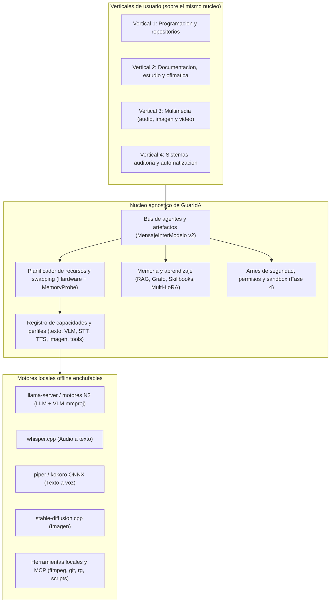
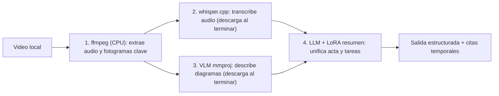

# 02 · Arquitectura agnóstica de dominio y red de agentes multimodales

> **Estado:** Visión futura / RFC conceptual (Fase 5+)  
> **Fecha:** 2026-11-28  
> **Contexto:** Evolución desde el enfoque inicial centrado en programación (*coder-only*) hacia una plataforma local offline capaz de orquestar redes de agentes especializados en texto, código, visión, audio, imagen, vídeo y ejecución.

---

## 1. Opinión técnica sobre el cambio de enfoque

### Por qué SÍ conviene desacoplar el núcleo del dominio "solo coder"
En realidad, GuarIdA ya empezó a romper la etiqueta "solo programación" de forma orgánica en sus propias decisiones de arquitectura:
- [ADR 0004](../adr/0004-arquitectura-multi-rol-aprovisionamiento-flexible.md) separó la conversación general en español (`Chat`), la programación (`Coder`), la indexación (`Embeddings`) y la auditoría sin filtros (`Sin Censura`).
- [ADR 0012](../adr/0012-arquitectura-persistencia-grafo-ast-y-vlm.md) incorporó ingesta visual con modelos VLM (`Qwen2-VL-2B-Instruct` + `mmproj`) y un servidor MCP (`mcp/server.py`).
- El subsistema de proyectos (`proyectos.py`) ya indexa Markdown y documentación general, no solo código Python.

Lo que realmente diferencia a GuarIdA en el mercado no es ser "otro asistente de código", sino **su capa de soberanía sobre hardware doméstico**: detectar qué cabe en tu máquina, exprimirlo empíricamente, proteger los datos en un búnker offline y aplicar seguridad fuera del modelo. **Esa propuesta de valor es completamente agnóstica al dominio.**

### Advertencia crítica: evitar la dispersión de alcance
El propio [README.md](../../README.md) recuerda por qué se abandonó el proyecto previo basado en KoboldCpp: intentar abarcar demasiado en la interfaz y dispersarse hizo que se descuidara la base.

Por eso, la postura arquitectónica recomendada es:
- **No abandonar programación:** mantener la ingeniería de software como la **Vertical #1 de referencia** (porque exige contexto largo, herramientas reales, diffs exactos y verificación automática por tests; si el núcleo aguanta programación, aguanta casi cualquier otro dominio).
- **Generalizar el núcleo, no multiplicar la UI sin control:** convertir la base en una plataforma de capacidades y agentes enchufables, abriendo nuevas verticales de una en una conforme el núcleo y la gestión de memoria estén maduros.

---

## 2. Arquitectura objetivo: Núcleo Agnóstico + Verticales

---

## 3. De `RolAgente` fijo a un Registro de Capacidades

Actualmente, [roles.py](../../app/guarida_manager/roles.py) define un `Enum` cerrado (`CONVERSACIONAL`, `CODER`, `EMBEDDING_INDEXER`, `REVIEWER`) y una clase `AsignacionRoles` con cuatro atributos fijos. De hecho, cuando se añadió el modelo VLM en [ADR 0012](../adr/0012-arquitectura-persistencia-grafo-ast-y-vlm.md), ya tuvo que gestionarse fuera de `AsignacionRoles`.

Para soportar una red de agentes multimodales sin modificar el código central cada vez que aparece una modalidad nueva, conviene separar dos conceptos:

1. **Capacidad técnica (qué transforma el motor):**
   - `text -> text` (razonamiento, chat, síntesis, planificación)
   - `text -> code_diff` (edición estructurada de código)
   - `image+text -> text` (VLM: lectura de capturas, diagramas, documentos escaneados)
   - `audio -> text` (STT: transcripción de voz, reuniones, notas)
   - `text -> audio` (TTS: lectura en voz alta, accesibilidad)
   - `text -> image` (generación de bocetos o recursos visuales)
   - `text -> embedding` / `rerank` (indexación y recuperación)
   - `tool_execution` (acciones deterministas: `ffmpeg`, `git`, `ripgrep`, parsers)

2. **Agente / Rol funcional (qué misión tiene y qué puede hacer):**
   Un agente se define declarativamente como:
   `Agente = Capacidad requerida + Prompt/Sistema + Adaptador LoRA opcional (scope) + Permisos del arnés (lectura, escritura, red, ejecución)`.

### Catálogo realista de motores offline para hardware doméstico
Siguiendo la filosofía portable y ligera de GuarIdA (priorizando binarios C/C++/Rust de la familia `ggml` u ONNX y licencias compatibles con GPL-3.0, evitando arrastrar entornos Python gigantes):

| Modalidad | Motor candidato offline | Por qué encaja en GuarIdA | Perfil mínimo realista |
|---|---|---|---|
| **LLM / Chat / Código / Razonamiento** | `llama-server` (+ motores N2 de [Estudio de inferencia](https://github.com/Ydalgo/GuarIdA/blob/estudio/motores-inferencia/docs/estudio_inferencia/README.md)) | Ya integrado, soporte Multi-LoRA, KV cuantizada y Vulkan/CPU. | Perfil A (0.6B–4B) en adelante |
| **Visión (VLM)** | `llama-server` + proyector `mmproj` | Ya validado en ADR 0012 (`Qwen2-VL-2B`); cero motores extra. | Perfil A/B |
| **Audio → Texto (STT)** | `whisper.cpp` | Mismo ecosistema `ggml`, binario único portable, CPU o Vulkan, muy ligero. | Perfil A |
| **Texto → Audio (TTS)** | `piper` o `kokoro` (ONNX) | Corre rápido en CPU sin robar VRAM a los modelos de texto/visión. | Perfil A |
| **Texto → Imagen** | `stable-diffusion.cpp` | Ecosistema `ggml`, sin PyTorch; viable con cuantización en VRAM media o APU paciente. | Perfil B alto / C / D |
| **Vídeo (análisis/resumen)** | **Pipeline compuesto:** `ffmpeg` + `whisper.cpp` + VLM (fotogramas clave) + LLM | **Clave:** evita necesitar modelos *omni* de vídeo nativos de >24 GB VRAM; funciona en cualquier Perfil A/B. | Perfil A/B |
| **Embeddings / Reranking** | `llama-server` / motor dedicado ligero | Ya operativo en `proyectos.py` y `indice_hibrido.py`. | Perfil A |
| **Ejecución / Utilidades** | Subproceso local + servidor MCP ([mcp/server.py](../../app/guarida_manager/mcp/server.py)) | Determinista, auditable y confinable en el futuro sandbox de Fase 4. | Perfil A |

---

## 4. El reto real: orquestar muchos especialistas en memoria finita

En la nube, una "red de agentes" suele significar tener 5 modelos cargados a la vez respondiendo en paralelo. **En un portátil con 16–32 GB de RAM compartida (Perfiles A y B), cargar cinco modelos simultáneos provoca *OOM* o *swapping* a disco que hunde el rendimiento.**

Para que una red de agentes sea viable en hardware doméstico, GuarIdA debe apoyarse en tres mecanismos coordinados por su **Planificador de Recursos (*Resource Broker*)**:

### 1. *Swapping* inteligente y estados de vida del modelo
Usando los límites empíricos de `memory_probe.py` y los perfiles guardados en SQLite:
- **Carga perezosa (*lazy load*):** un agente solo sube a memoria cuando el grafo de tareas llega a su paso.
- **Descarga ordenada y persistencia de estado:** antes de cargar un agente pesado (p. ej. `stable-diffusion.cpp` o un Coder 8B), el planificador descarga el agente anterior y, si procede, guarda su caché KV en disco (`--slot-save-path`) para reanudarlo sin re-prefill completo.
- **Co-residencia selectiva:** en CPU/RAM sobrante (Perfiles B/C/D), modelos diminutos como `piper` (TTS) o `embeddings` pueden permanecer residentes mientras la GPU/iGPU rota el modelo pesado activo.

### 2. Router ultraligero residente + Multi-LoRA sobre un único modelo base
Aquí convergen directamente el [documento 01](01_aprendizaje_adaptativo_local.md) y esta arquitectura:
- Un **Router pequeño (0.6B–1.7B)** o clasificador híbrido permanece siempre cargado (~0.5–1.2 GB) para entender al usuario, planificar el DAG de tareas y decidir qué especialistas invocar.
- Para tareas distintas de texto (resumir, programar, auditar, redactar), en vez de cargar 3 modelos base diferentes de 5 GB cada uno, el planificador carga **1 solo modelo base GGUF** y conmuta **adaptadores LoRA `.gguf` de ~30–100 MB** en caliente.

### 3. Ejecución por fases (Pipeline DAG en vez de todos a la vez)
Ejemplo de flujo multimodal real en un **Perfil B (APU 32 GB)** ante una petición como *"Analiza esta grabación de reunión, extrae los diagramas y crea un resumen de tareas"*:

En ningún momento conviven `whisper.cpp`, el VLM y el LLM completo compitiendo por toda la VRAM/GTT; aun así, para el usuario la experiencia es continua y automática.

---

## 5. Evolución de `MensajeInterModelo` y seguridad del arnés

### Mensajes por referencia a artefactos locales
`MensajeInterModelo` ([roles.py](../../app/guarida_manager/roles.py)) hoy intercambia JSON de texto. En una red multimodal, pasar audio o imágenes en base64 dentro del prompt rompería la ventana de contexto.

La evolución natural es que el `payload` transporte **referencias tipadas a artefactos en el espacio de trabajo del búnker**:
- `ruta_local` (validada dentro del proyecto o directorio temporal de sesión, nunca rutas arbitrarias del sistema).
- `mime_type` (`audio/wav`, `image/png`, `text/x-diff`, `application/json`).
- `sha256` (integridad y caché: si el artefacto ya fue transcrito o indexado, no se repite trabajo).
- `etiqueta_privacidad` (`estandar`, `privado`, `rgpd_redactado`) heredada de `sanitizer.py`.

### Seguridad fuera del modelo y MCP
- **Ningún agente tiene permisos implícitos:** que un agente procese una imagen, un audio o un documento externo (riesgo de *prompt injection* indirecta en imágenes o transcripciones) **no** le da permiso para ejecutar comandos ni escribir archivos. El arnés de GuarIdA y el futuro sandbox de Fase 4 aplican una lista blanca de herramientas por agente.
- **MCP como puente bidireccional:** igual que [mcp/server.py](../../app/guarida_manager/mcp/server.py) ya expone herramientas de GuarIdA hacia fuera, el mismo estándar permite a GuarIdA consumir herramientas locales encapsuladas en el futuro sin acoplar su código interno.

---

## 6. Hoja de ruta de transición incremental

| Horizonte | Qué ocurre | Cómo prepara esta visión sin desviar foco |
|---|---|---|
| **Corto plazo (Fase 3 · Estudio F4–F6)** | Se cierra la orquestación de código y se decide la arquitectura de motores (ADR 0014). | Diseñar la interfaz de motores enchufables (N2) por **capacidad** (`MotorCapacidad`) en lugar de asumir un único servidor de texto. |
| **Medio plazo (Fase 4 · Aislamiento)** | Sandboxing a nivel de sistema operativo para herramientas y subprocesos. | Aplicar el mismo modelo de permisos por agente para que cualquier binario futuro (`whisper.cpp`, `ffmpeg`, `sd.cpp`) nazca confinado. |
| **Largo plazo (Fase 5+ · Red y Aprendizaje)** | Planificador de memoria/*swapping*, Bus de artefactos, catálogo multimodal y *Adaptive Learning Engine* (`L0`–`L3`). | Integración de verticales nuevas reutilizando el hardware-profiling, SQLite, Multi-LoRA y MCP ya consolidados. |

---

## 7. Opinión técnica final (síntesis)

La mayoría de herramientas de IA local hoy se dividen en dos extremos: lanzadores simples que solo sirven un chat con un `.gguf`, o *frameworks* pesados pensados para servidores con varias GPUs en PyTorch/Docker.

Si GuarIdA combina:
1. **Conocimiento empírico real del hardware doméstico** (lo que ya hace hoy),
2. **Orquestación de agentes multimodales con *swapping* de memoria y Multi-LoRA** (este documento), y
3. **Aprendizaje adaptativo escalonado `L0`–`L3` seguro y respetuoso con la privacidad** ([documento 01](01_aprendizaje_adaptativo_local.md)),

puede convertirse en algo genuinamente distinto: **un sistema operativo local de agentes soberanos capaz de adaptarse tanto al hardware exacto de cada persona como a su forma de trabajar**, sin depender de la nube ni exigir conocimientos técnicos avanzados.
